<picture>
  <source media="(prefers-color-scheme: dark)" srcset="assets/banner-dark.svg">
  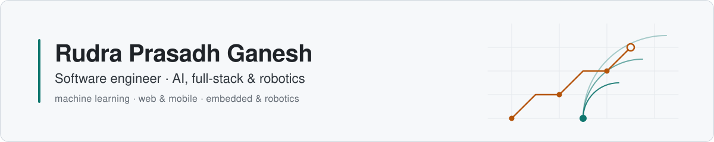
</picture>

I am a software engineer in Singapore who builds AI-backed products end to end: the model, the services around it and the web or mobile app people use. I am currently applying that to robots at **Fabrica AI**, after a Computer Engineering degree at NTU Singapore where I graduated with the Lee Kuan Yew Gold Medal.

<picture>
  <source media="(prefers-color-scheme: dark)" srcset="assets/plates/numbers-dark.svg">
  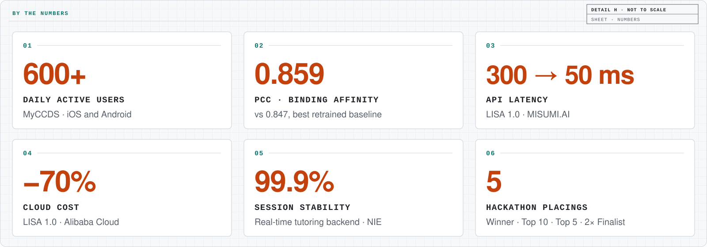
</picture>

## Now

- **Fabrica AI**: sole software engineer on the ROS 2 codebase of an autonomous tile-grouting robot, deployed in Singapore and Australia.
- **Lumerva**: co-founder and full-stack engineer on a learning platform. React and TypeScript, a Python backend with Celery and Redis, the YouTube Data API and the Brave Search API.
- **Also shipping**: MyCCDS, an iOS and Android app for NTU CCDS students, live on the [App Store](https://apps.apple.com/us/app/myccds/id6753279278) and [Google Play](https://play.google.com/store/apps/details?id=com.ntu.myccds) with 600+ daily active users.

## AI & ML

- **MHC-peptide binding prediction**, Final Year Project: ESM-2 (650M) plus AlphaFold-derived structure, LoRA/PEFT in PyTorch; PCC 0.859 against 0.847 for the best retrained baseline. Submitted to ICLR 2027. [Repo](https://github.com/Unknown-Blaze/FYP-Research)
- **LISA 1.0**, MISUMI.AI: RAG automotive advisor on Next.js 15 and PostgreSQL, in production across 4 ASEAN markets; API latency 300 ms to 50 ms, cloud cost down 70%. Not public.
- **Intelligent tutoring system**, National Institute of Education: real-time WebSocket backend with 99.9% session stability, a 60-participant study and the AIED 2026 paper. [Paper](https://doi.org/10.1007/978-3-032-29791-4_2)
- **YOLOv8 inference API**, Panasonic R&D Center Singapore: FastAPI and Docker, with async processing for real-time workflows. Not public.
- **FunctionGemma**, National Top 10, Cactus x Google Global Hackathon: function calling routed between an on-device model and the cloud. [Repo](https://github.com/Unknown-Blaze/functiongemma-hackathon)
- **Truth Fairy**, Top 5, NTU TechFest: Chrome extension against misinformation, with deepfake detection and Grad-CAM explanations. [Repo](https://github.com/Unknown-Blaze/techfest-truth-fairy)
- **Bloomberg Code Crunch**: deep-learning trading-signal pipeline with LSTM, GRU and Transformer models and a backtest that includes transaction costs. Private repo.
- **BirdCLEF**, Kaggle competition project for SC4000. Private repo.
- **CareerAxis automator**: an LLM pipeline that collects NTU CareerAxis job listings and drafts tailored applications. Private repo.
- **Edge-AI motion detection**, URECA research poster: 96% accuracy at 180 ms latency on an ODROID N2.

Also: [full fine-tuning vs LoRA for sentiment analysis](https://github.com/Unknown-Blaze/SC4001-Group-Project) · [PSA Code Sprint](https://github.com/Unknown-Blaze/PSASprint) finalist, time-series forecasting

     

<table>
  <tr>
    <td width="50%" valign="top">
<picture>
  <source media="(prefers-color-scheme: dark)" srcset="assets/plates/plate-fyp-dark.svg">
  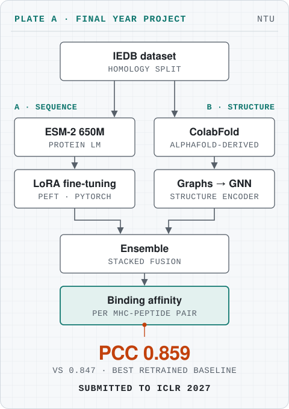
</picture>
    </td>
    <td width="50%" valign="top">
<picture>
  <source media="(prefers-color-scheme: dark)" srcset="assets/plates/plate-lisa-dark.svg">
  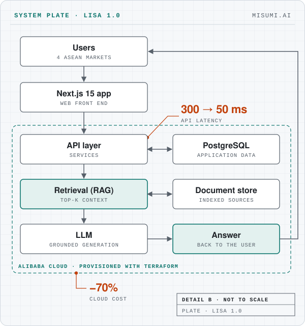
</picture>
    </td>
  </tr>
</table>

## Selected work

<table>
  <tr>
    <td width="50%" valign="top">
      <a href="https://play.google.com/store/apps/details?id=com.ntu.myccds">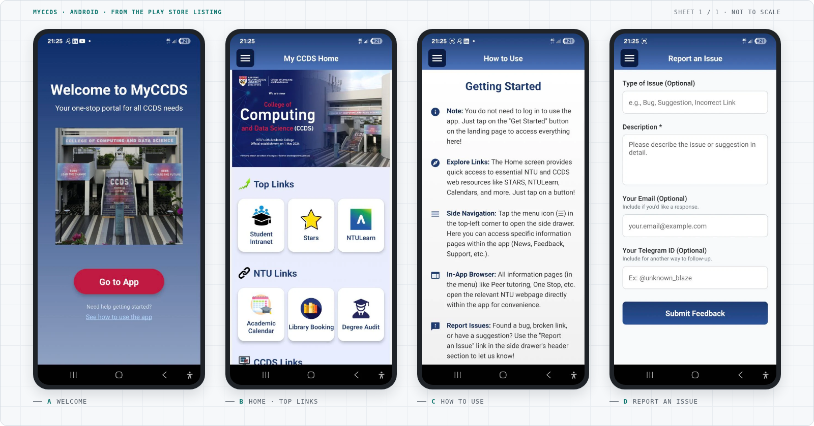</a> 
      <b>MyCCDS</b> 
      iOS and Android app for NTU CCDS students, 600+ daily active users. 
      <a href="https://play.google.com/store/apps/details?id=com.ntu.myccds">Play Store</a> · <a href="https://apps.apple.com/us/app/myccds/id6753279278">App Store</a> · <a href="https://www.ntu.edu.sg/computing/news-events/news/detail/ganesh-rudra-prasadh-transforms-student-experience-with-myccds">Press</a>
    </td>
    <td width="50%" valign="top">
      <a href="https://github.com/Unknown-Blaze/FYP-Research">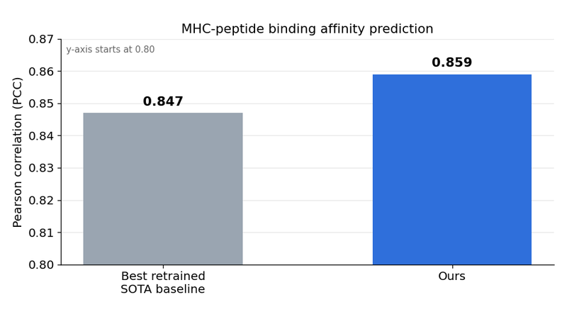</a> 
      <b>MHC-peptide binding prediction</b> 
      Final Year Project: ESM-2 plus AlphaFold structure. Submitted to ICLR 2027. 
      <a href="https://github.com/Unknown-Blaze/FYP-Research">Repo</a>
    </td>
  </tr>
  <tr>
    <td width="50%" valign="top">
      <a href="https://github.com/Unknown-Blaze/SC4053-Project">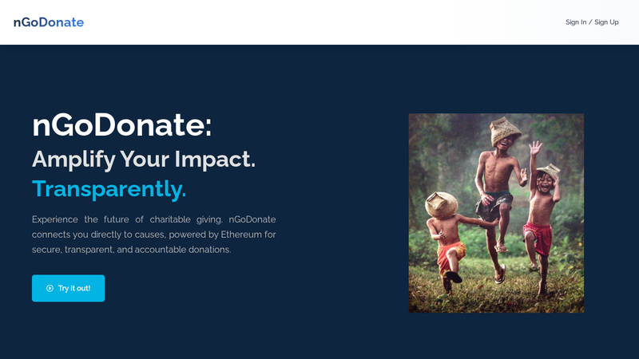</a> 
      <b>nGoDonate</b> 
      Donations with NFT receipts. Winner, Best Developer Tooling, EasyA x Ripple. 
      <a href="https://github.com/Unknown-Blaze/SC4053-Project">Repo</a> · <a href="https://github.com/Unknown-Blaze/easya-hackathon">Hackathon repo</a> · <a href="https://easya-hackathon-tawny.vercel.app">Live</a>
    </td>
    <td width="50%" valign="top">
      <a href="https://mango-club.vercel.app">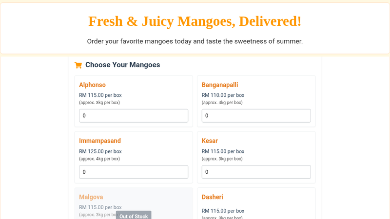</a> 
      <b>Mango order management</b> 
      Order management with online payments: React, Firebase, Stripe. 
      <a href="https://mango-club.vercel.app">Live</a>
    </td>
  </tr>
  <tr>
    <td width="50%" valign="top">
      <a href="https://synctube-tau.vercel.app">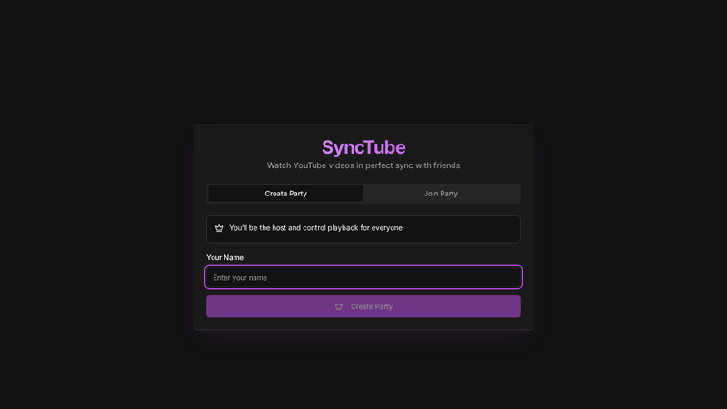</a> 
      <b>SyncTube</b> 
      Watch YouTube with friends, in sync, in real time. 
      <a href="https://github.com/Unknown-Blaze/synctube">Repo</a> · <a href="https://synctube-tau.vercel.app">Live</a>
    </td>
    <td width="50%" valign="top">
      <a href="https://blazing-chess.vercel.app">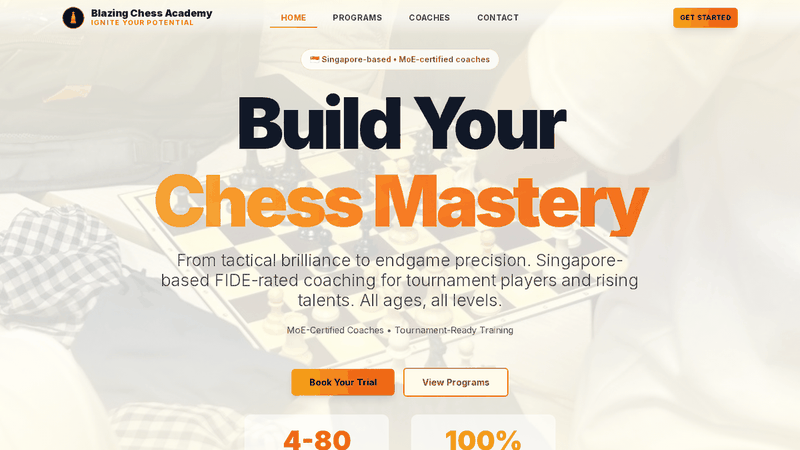</a> 
      <b>Blazing Chess</b> 
      Website for a chess academy. 
      <a href="https://github.com/Unknown-Blaze/blazing-chess">Repo</a> · <a href="https://blazing-chess.vercel.app">Live</a>
    </td>
  </tr>
</table>

## Software engineering

- **MyCCDS**: React Native and Expo app for NTU CCDS students, 600+ daily active users on both stores. [Press](https://www.ntu.edu.sg/computing/news-events/news/detail/ganesh-rudra-prasadh-transforms-student-experience-with-myccds)
- **Mango order management**: ordering and online payments for a retailer with React, Firebase and Stripe. [Live](https://mango-club.vercel.app)
- **SyncTube**: YouTube watch parties kept in sync in real time, Next.js 15 and Socket.IO. [Repo](https://github.com/Unknown-Blaze/synctube) · [Live](https://synctube-tau.vercel.app)
- **Blazing Chess**: website for a chess academy, Next.js 14, TypeScript and Tailwind CSS. [Repo](https://github.com/Unknown-Blaze/blazing-chess) · [Live](https://blazing-chess.vercel.app)
- **Sustainability analytics platform**, MODEC: React on a Django REST Framework backend handling 500+ concurrent requests; Redis cut retrieval time by 40%; IoT ingestion through AWS Lambda and S3. Not public.
- **CCDS alumni platform**, NTU: networking platform connecting alumni and students for startup and event collaboration (WordPress, PHP, SQL). Not public.
- **Kaboo**: the Kaboo card game in the browser with an AI opponent, React, TypeScript and Firebase. Private repo.

Also: [nGoDonate](https://github.com/Unknown-Blaze/SC4053-Project), Winner, Best Developer Tooling, EasyA x Ripple · [GroceryGrabber](https://github.com/Unknown-Blaze/BrainHacks-Code-Exp), DSTA BrainHack finalist

           

<table>
  <tr>
    <td width="50%" valign="top">
<picture>
  <source media="(prefers-color-scheme: dark)" srcset="assets/plates/plate-myccds-dark.svg">
  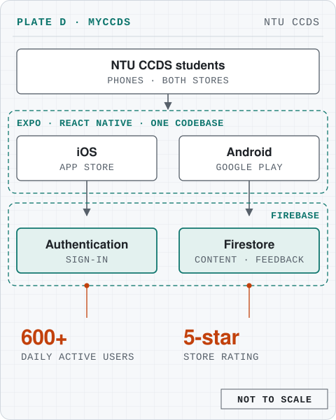
</picture>
    </td>
    <td width="50%" valign="top">
<picture>
  <source media="(prefers-color-scheme: dark)" srcset="assets/plates/plate-modec-dark.svg">
  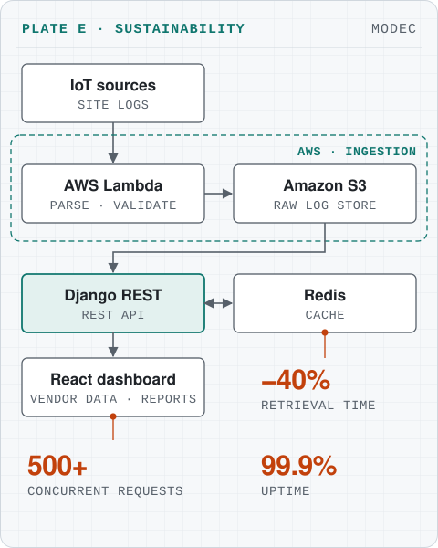
</picture>
    </td>
  </tr>
</table>

## Robotics & embedded

- **Fabrica AI**: ROS 2 autonomy for a construction robot: perception (LiDAR, cameras), SLAM and navigation, motion planning, behaviour trees and Gazebo simulation. Led a LiDAR upgrade in one month.
- **Schaeffler Hub for Advanced Research**: CAN bus master-slave firmware on the XMC4800, EtherCAT, FreeRTOS and STM32F4.
- **Microprocessor labs** on the TI-RSLK robot: line following and obstacle avoidance in C and assembly. [Repo](https://github.com/Unknown-Blaze/Microprocessor-System-Design)

    

## Experience

<picture>
  <source media="(prefers-color-scheme: dark)" srcset="assets/timeline/timeline-dark.svg">
  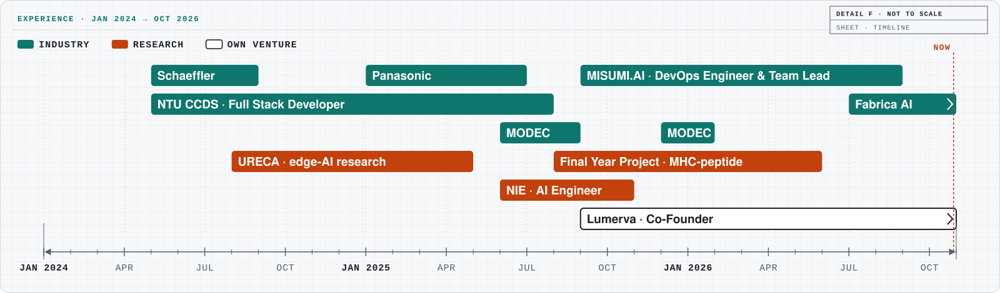
</picture>

## Research

- Sinha, T., Huang, R., & Ganesh, R. P. (2026). *Scaffolding Emotion Regulation in Productive Failure Using an AIED System: Prototyping and Evaluation.* AIED 2026, CCIS, pp. 17-32, Springer. [doi:10.1007/978-3-032-29791-4_2](https://doi.org/10.1007/978-3-032-29791-4_2)
- MHC-peptide binding affinity prediction with ESM-2 and AlphaFold-derived structure. Submitted to ICLR 2027.
- Edge-AI motion detection for IoT security on an ODROID N2 (URECA research poster, NTU, 2025). 96% motion-detection accuracy at 180 ms latency; President Research Scholar.

## Beyond code

President and captain of the NTU International Chess Varsity, music director of the NTU Piano Ensemble (ABRSM Grade 8, Distinction), and a Malaysia National Cubing Open finalist.

## Contact

[grudraprasadh@gmail.com](mailto:grudraprasadh@gmail.com) · [LinkedIn](https://www.linkedin.com/in/unknown-blaze) · [Portfolio](https://unknown-blaze.github.io/portfolio)
