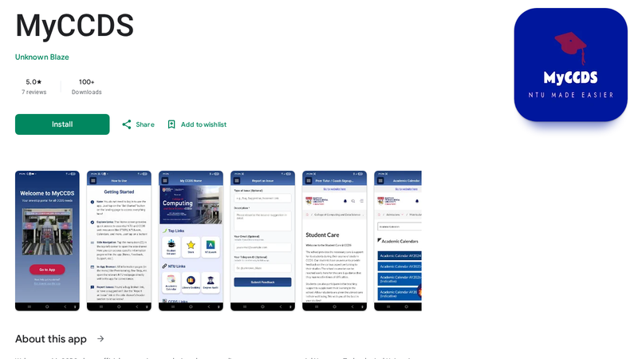

<picture>
  <source media="(prefers-color-scheme: dark)" srcset="assets/banner-dark.svg">
  
</picture>

I am a software engineer at **Fabrica AI** in Singapore, working across software, embedded hardware and machine learning. I studied Computer Engineering at NTU Singapore and graduated with the Lee Kuan Yew Gold Medal.

## Now

- **Fabrica AI**: sole software engineer on an autonomous tile-grouting robot for construction, deployed in Singapore and Australia. Perception (LiDAR, cameras), SLAM and navigation, motion planning, behaviour trees, Gazebo simulation, Docker and GitHub Actions. Led a LiDAR upgrade in one month.

        

- **Lumerva**: co-founder and full-stack engineer on a learning platform. React and TypeScript, a Python backend with Celery and Redis, the YouTube Data API and the Brave Search API.

     

## Selected work

<table>
  <tr>
    <td width="50%" valign="top">
       
      <b>MyCCDS</b> 
      iOS and Android app for NTU CCDS students, 600+ daily active users. 
      <a href="https://play.google.com/store/apps/details?id=com.ntu.myccds">Play Store</a> · <a href="https://apps.apple.com/us/app/myccds/id6753279278">App Store</a> · <a href="https://www.ntu.edu.sg/computing/news-events/news/detail/ganesh-rudra-prasadh-transforms-student-experience-with-myccds">Press</a>
    </td>
    <td width="50%" valign="top">
       
      <b>nGoDonate</b> 
      Donations with NFT receipts. Winner, Best Developer Tooling, EasyA x Ripple. 
      <a href="https://github.com/Unknown-Blaze/SC4053-Project">Repo</a> · <a href="https://github.com/Unknown-Blaze/easya-hackathon">Hackathon repo</a> · <a href="https://easya-hackathon-tawny.vercel.app">Live</a>
    </td>
  </tr>
  <tr>
    <td width="50%" valign="top">
       
      <b>Blazing Chess</b> 
      Website for a chess academy. 
      <a href="https://github.com/Unknown-Blaze/blazing-chess">Repo</a> · <a href="https://blazing-chess.vercel.app">Live</a>
    </td>
    <td width="50%" valign="top">
       
      <b>SyncTube</b> 
      Watch YouTube with friends, in sync, in real time. 
      <a href="https://github.com/Unknown-Blaze/synctube">Repo</a> · <a href="https://synctube-tau.vercel.app">Live</a>
    </td>
  </tr>
  <tr>
    <td width="50%" valign="top">
       
      <b>Mango order management</b> 
      Order management with online payments: React, Firebase, Stripe. 
      <a href="https://mango-club.vercel.app">Live</a>
    </td>
    <td width="50%" valign="top">
       
      <b>MHC-peptide binding prediction</b> 
      Final Year Project: ESM-2 plus AlphaFold structure. Submitted to ICLR 2027. 
      <a href="https://github.com/Unknown-Blaze/FYP-Research">Repo</a>
    </td>
  </tr>
</table>

Also: LISA 1.0, an automotive advisor in production across 4 ASEAN markets (not public) · [Fine-tuning vs LoRA](https://github.com/Unknown-Blaze/SC4001-Group-Project) · [Truth Fairy](https://github.com/Unknown-Blaze/techfest-truth-fairy), Top 5, NTU TechFest · [FunctionGemma](https://github.com/Unknown-Blaze/functiongemma-hackathon), National Top 10, Cactus x Google · [GroceryGrabber](https://github.com/Unknown-Blaze/BrainHacks-Code-Exp), DSTA BrainHack finalist · [PSA Code Sprint](https://github.com/Unknown-Blaze/PSASprint) finalist

      

## Research

- Sinha, T., Huang, R., & Ganesh, R. P. (2026). *Scaffolding Emotion Regulation in Productive Failure Using an AIED System: Prototyping and Evaluation.* AIED 2026, CCIS, pp. 17-32, Springer. [doi:10.1007/978-3-032-29791-4_2](https://doi.org/10.1007/978-3-032-29791-4_2)
- MHC-peptide binding affinity prediction with ESM-2 and AlphaFold-derived structure. Submitted to ICLR 2027.
- Edge-AI motion detection for IoT security on an ODROID N2 (URECA research paper, NTU, 2025). 96% motion-detection accuracy at 180 ms latency; President Research Scholar.

   

## Hardware

Embedded firmware at Schaeffler Hub for Advanced Research: a CAN bus master-slave system on the XMC4800, EtherCAT, FreeRTOS and STM32F4. Edge AI on an ODROID N2, and microcontroller projects.

   

## Beyond code

President and captain of the NTU International Chess Varsity, music director of the NTU Piano Ensemble (ABRSM Grade 8, Distinction), and a Malaysia National Cubing Open finalist.

## Contact

[grudraprasadh@gmail.com](mailto:grudraprasadh@gmail.com) · [LinkedIn](https://www.linkedin.com/in/unknown-blaze) · [Portfolio](https://unknown-blaze.github.io/portfolio)
